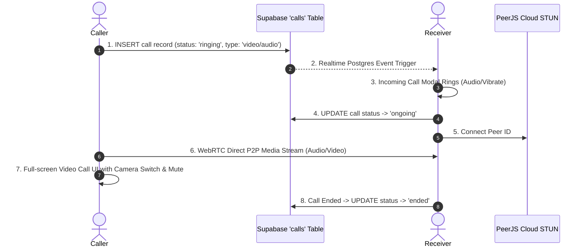

# 🚀 WhatsApp Pro - Complete Project Flow & Architecture Guide

> **Document Type:** Comprehensive Technical & Feature Flow  
> **Project Name:** WhatsApp Pro (Next.js 16 + React 19)  
> **Repository:** [whatsapp](file:///home/ts/Videos/M/My%20Project/Whatsapp/whatsapp)

---

## 📌 1. High-Level Overview

**WhatsApp Pro** ek high-performance, mobile-first real-time chat aur audio/video calling progressive web application (PWA) hai. Isme WhatsApp jaise identical features implement kiye gaye hain: 1-on-1 direct messages, group chats, voice notes with interactive waveforms, media sharing (images, videos, documents), emoji reactions, message replies, WebRTC peer-to-peer calls, push notifications, aur full settings customization.

```mermaid
graph TD
    Client[Next.js 16 Client - React 19] -->|REST & Realtime PubSub| Supabase[Supabase PostgreSQL & Auth]
    Client -->|Upload / Download Media| Storage[Supabase Storage 'chat-media']
    Client -->|P2P Audio & Video Call| PeerJS[PeerJS / WebRTC STUN Server]
    Client -->|Push Subscription| SW[Service Worker & Web-Push API]
    NextAPI[Next.js Server API Routes] -->|Service Role Bypasses RLS| Supabase
    NextAPI -->|Dispatch Web Push| WebPush[Web Push Service]
    Cron[Vercel Cron / GitHub Actions / Health Ping] -->|Keep Supabase Awake| HealthAPI[/api/health]
```

---

## 🛠️ 2. Tech Stack Breakdown (Feature-by-Feature)

| Feature / Module | Technology & Library Used | Purpose / Role |
| :--- | :--- | :--- |
| **Framework & Core** | **Next.js 16.2.4 (Turbopack, App Router)** | SSR, Static Generation & Dynamic API Routes |
| **Frontend UI** | **React 19.2.4 + TypeScript 5** | Reactive Component Model & Type Safety |
| **Styling & Theme** | **Tailwind CSS v4 + PostCSS** | Modern mobile-first responsive utility styling |
| **Animations** | **Motion (`motion/react` v12.38.0)** | Smooth page transitions, modals & floating sheets |
| **Icons** | **Lucide React (`lucide-react`)** | WhatsApp-accurate clean vector iconography |
| **UI Components** | **Radix UI / Shadcn UI + Base UI** | Accessible modals, sheets, dialogs, dropdowns |
| **Database & Auth** | **Supabase (`@supabase/supabase-js`)** | PostgreSQL DB, Row Level Security (RLS), Auth |
| **Realtime Sync** | **Supabase Realtime (`postgres_changes`, channels)** | Instant message delivery, typing indicators, presence |
| **Media Storage** | **Supabase Storage (`chat-media` bucket)** | Avatars, chat photos, videos, voice recordings, PDFs |
| **Voice & Video Calls** | **PeerJS (`peerjs` v1.5.5) + WebRTC** | P2P audio/video stream transmission with STUN servers |
| **Call Signaling** | **Supabase `calls` table + Realtime** | Ringing, Call Answer, Reject, End, Missed call sync |
| **Push Notifications** | **`web-push` + Service Worker (`sw.js`)** | Background notifications when app is closed or in background |
| **Image Zoom & Pan** | **`react-zoom-pan-pinch`** | Full-screen image viewing with double-tap zoom |
| **Toasts & Feedback** | **Sonner (`sonner` v2.0.7)** | Sleek top-center notifications |
| **Date Formatting** | **Date-fns (`date-fns` v4.1.0)** | Relative time labels ("just now", "5m ago", "12:45 PM") |
| **Keep-Alive System** | **`/api/health`, Vercel Cron, GitHub Actions** | Supabase free-tier 7-day dormancy protection |

---

## 📂 3. Folder & File Directory Map

```text
whatsapp/
├── .github/workflows/
│   └── supabase-keepalive.yml   # Scheduled GitHub Actions keep-alive ping
├── public/
│   ├── sw.js                    # Web Push service worker
│   ├── manifest.json            # PWA manifest
│   └── chat-bg-*.png            # Chat wallpapers & sound assets
├── scripts/
│   └── keepalive.mjs            # Standalone node script to ping Supabase
├── src/
│   ├── app/
│   │   ├── api/
│   │   │   ├── health/route.ts  # Supabase health & keepalive API
│   │   │   ├── keepalive/route.ts # Keepalive route alias
│   │   │   └── push/route.ts    # Server-side web push dispatch route
│   │   ├── auth/page.tsx        # Authentication & Profile login
│   │   ├── calls/page.tsx       # Call logs & new call trigger screen
│   │   ├── chat/[groupId]/page.tsx # Core Chat Room (Media, Voice, Text, Info)
│   │   ├── groups/page.tsx      # Community & Group creation screen
│   │   ├── settings/page.tsx    # User preferences, themes, wallpaper, privacy
│   │   ├── layout.tsx           # Root layout with PWA meta, fonts & CallProvider
│   │   └── page.tsx             # Home Screen (Recent chat list & DM search)
│   ├── components/
│   │   ├── CallContext.tsx      # Global WebRTC/PeerJS calling state manager
│   │   ├── CallScreen.tsx       # Incoming/Ongoing call full-screen overlay UI
│   │   ├── layout/
│   │   │   ├── BottomNav.tsx    # Mobile bottom tab navigation (Chats, Calls, etc.)
│   │   │   ├── ClientLayout.tsx # Client-side wrapper with onboarding check
│   │   │   └── Onboarding.tsx   # First-time user profile setup modal
│   │   ├── settings/            # Settings screens (Profile, Privacy, Chats, etc.)
│   │   └── ui/                  # Reusable UI components (Dialog, Avatar, Sheet, etc.)
│   └── lib/
│       ├── auth.ts              # LocalStorage & Supabase Auth session helpers
│       ├── push.ts              # Client-side service worker push registration
│       ├── supabase.ts          # Public Supabase client for client-side queries
│       ├── supabase-server.ts   # Admin Supabase client (Service Role key)
│       └── utils.ts             # Tailwind class merging utility (clsx + twMerge)
├── vercel.json                  # Vercel Cron schedule configuration
├── SCHEMA.sql                   # Main PostgreSQL database tables & RLS policies
├── calls_schema.sql             # Calls table & realtime publication schema
└── settings_schema.sql          # User settings schema & auto-create triggers
```

---

## 🔄 4. Complete End-to-End Application Flows

### Flow 1: User Onboarding & Identity
1. **First Visit**:
   - User app open karta hai. `ClientLayout.tsx` check karta hai `getCurrentUser()`.
   - Agar local storage / Supabase me user profile nahi milti, to `Onboarding.tsx` modal render hota hai.
2. **Profile Setup**:
   - User apna username choose karta hai aur avatar select/upload karta hai.
   - Profile `profiles` table me create hoti hai (`id`, `username`, `avatar_url`, `status`, `last_seen`).
   - `settings_schema.sql` ka database trigger automatically user ke liye default `user_settings` record create kar deta hai.
   - User identity `localStorage` (`whatsapp_current_user`) aur Supabase session me store ho jati hai.

---

### Flow 2: Home Screen & Chat List Management (`src/app/page.tsx`)
1. **Fetching Conversations**:
   - App user ke saare joined groups aur 1-on-1 direct messages fetch karti hai (`groups` + `group_members`).
2. **Realtime Updates on Home Screen**:
   - Supabase Realtime channel `chat-list-updates` listen karta hai `messages` table ke `INSERT` events ko.
   - Naya message aane par latest message text, timestamp, aur unread count bina refresh kiye turant top par move ho jata hai.
3. **Starting a New 1-on-1 Chat**:
   - User Search icon par click karta hai. Username type karte hi Supabase `profiles` search hoti hai.
   - Selected user ke saath agar pehle se DM group exist karta hai to direct navigate hota hai; warna naya `type: 'dm'` group create karke dono users ko `group_members` me add kar diya jata hai.
4. **Creating a Community/Group (`src/app/groups/page.tsx`)**:
   - Group name, description aur group avatar upload kiya jata hai.
   - Group create hote hi creator automatically `admin` role ke saath add ho jata hai.

---

### Flow 3: Inside The Chat Room (`src/app/chat/[groupId]/page.tsx`)

Yeh project ka sabse advanced component hai, jisme nimn features integrate hain:

#### A. Text & Rich Messaging
- **Input & Send**: Enter key ya Send button dabate hi optimistic UI update hota hai aur message `messages` table me insert hota hai.
- **Quoted Replies (`reply_to`)**: Kisi bhi message par swipe ya reply dabane par `reply_to` state activate hoti hai, jo quoted preview box dikhati hai.
- **Message Delete / Unsend**: Sender apne message ko unsend ya delete kar sakta hai.

#### B. Voice Notes (Audio Messages)
- **Audio Recording**: HTML5 `MediaRecorder` API use karke microphone se direct compressed audio capture hota hai.
- **Storage**: Audio blob Supabase Storage ke `chat-media/voice-notes/` me upload hota hai.
- **Interactive Audio Player (`AudioMessagePlayer`)**:
  - WhatsApp jaisa 60-bar fine waveform dikhata hai.
  - Seekable timeline (waveform par tap karke scrub karna).
  - Variable speed playback button (`1x` ➔ `1.5x` ➔ `2x`).

#### C. Media Upload & Viewing
- **Camera & Gallery**: Photos, Videos aur Documents (PDF, DOCX) input file handler ke through upload hote hain.
- **Image Zoom (`react-zoom-pan-pinch`)**: Photos par tap karne par full-screen lightbox khulta hai jisme pinch-to-zoom aur double-tap zoom enabled hai.

#### D. Reactions & Read Receipts
- **Reactions**: Message par long-press karke WhatsApp style emoji quick bar (❤️, 👍, 😂, 😮, 😢, 🙏) se react kar sakte hain. Reactions JSONB me store hote hain.
- **Read Receipts**: Receiver ke open karte hi `read_by` JSON array update hoti hai aur sender ke side double blue checkmark (`CheckCheck` in blue) show hota hai.

#### E. Typing Indicator & Online Presence
- Supabase Realtime Channel presence state track karta hai:
  - Jab user typing start karta hai, to `typing: true` broadcast hota hai.
  - Dusre user ke header me animated *"typing..."* status render hota hai.

---

### Flow 4: WebRTC Voice & Video Calling (`CallContext.tsx` & `CallScreen.tsx`)

Calling feature pure peer-to-peer (P2P) WebRTC architecture par chalta hai:



1. **Initiate Call**:
   - Caller Chat Header se Phone ya Video icon par click karta hai.
   - `CallContext.tsx` Supabase `calls` table me naya row add karta hai (`status: 'ringing'`).
2. **Receiving Call**:
   - Receiver ke browser me Supabase Realtime event listen hota hai.
   - `CallScreen.tsx` full-screen incoming call UI display karta hai (Ringtone sound, Caller avatar, Accept/Decline buttons).
3. **P2P Audio/Video Handshake**:
   - Accept dabate hi `navigator.mediaDevices.getUserMedia` se local stream acquire hoti hai.
   - PeerJS P2P connection establish karta hai aur remote video/audio feed render hoti hai.
4. **Call Controls**:
   - Mic Mute / Unmute
   - Camera On / Off
   - Flip Camera (Front / Back on mobile)
   - Disconnect / End Call

---

### Flow 5: Web Push Notifications (`src/lib/push.ts` & `src/app/api/push`)

Jab user app se bahar ho ya screen locked ho:
1. **Subscription**:
   - Client side par `subscribeToPush(userId)` call hota hai jo browser ke Service Worker se VAPID endpoint aur keys (`p256dh`, `auth`) lekar Supabase `push_subscriptions` me store karta hai.
2. **Server-Side Dispatch**:
   - Jab koi user chat me message bhejta hai, to `POST /api/push` call hota hai.
   - Endpoint `supabaseServer` (Service Role Key) se group members ke push endpoints fetch karta hai aur `web-push` library se encrypted payload bhejta hai.
3. **Service Worker (`public/sw.js`)**:
   - Device background me push event receive karti hai aur native OS banner show karti hai ("New message from Ashish").
   - Notification par click karne par direct relevant chat open ho jati hai.

---

### Flow 6: Settings & Personalization (`src/app/settings`)

User settings context (`SettingsContext.tsx`) aur modular screens se customize kiya ja sakta hai:
- **Profile Screen**: Display name, about status, aur profile avatar update.
- **Chats Screen**:
  - Theme Selection: `Light`, `Dark`, ya `System` mode.
  - Wallpaper Selector: Custom background wallpapers.
  - Font Size: Small, Medium, Large.
  - Enter is Send toggle.
- **Privacy Screen**:
  - Last Seen visibility (`everyone`, `my_contacts`, `nobody`).
  - Read receipts toggle (Blue ticks enable/disable).
  - Profile photo visibility.

---

### Flow 7: Supabase Keep-Alive & Health Monitoring (`/api/health`)

Supabase Free Tier projects 7 din bina activity ke **pause/sleep mode** me chale jaate hain. Isko prevent karne ke liye:

1. **Endpoint (`/api/health` & `/api/keepalive`)**:
   - Active database query run karta hai (`profiles` count/select).
   - Response me exact latency, active connection status, aur masked project URL return karta hai.
   - `Cache-Control: no-store` ensure karta hai ki koi bhi CDN cache na kare aur har call real PostgreSQL hit bane.
2. **Automation**:
   - **Vercel Cron (`vercel.json`)**: Deployed app har 2 din me automated GET request receive karta hai.
   - **GitHub Actions (`.github/workflows/supabase-keepalive.yml`)**: Cloud workflow scheduled tarike se direct ping bhejta hai.
   - **CLI Tool (`scripts/keepalive.mjs`)**: `npm run keepalive` local/server testing ke liye.

---

## 🗄️ 5. Database Schema Matrix

```text
┌──────────────┐       ┌──────────────┐       ┌─────────────────┐
│   profiles   │───┬──<│ group_members│>──┬───│     groups      │
└──────────────┘   │   └──────────────┘   │   └─────────────────┘
       │           │                      │            │
       │           │                      │            │
       ▼           ▼                      │            ▼
┌──────────────┐ ┌──────────────┐         │   ┌─────────────────┐
│user_settings │ │    calls     │         └──<│    messages     │
└──────────────┘ └──────────────┘             └─────────────────┘
```

1. **`profiles`**: User details (`id`, `username`, `avatar_url`, `status`, `last_seen`).
2. **`groups`**: Rooms (`id`, `name`, `description`, `avatar_url`, `type: 'group' | 'dm'`).
3. **`group_members`**: Join table (`group_id`, `user_id`, `role: 'admin' | 'member'`).
4. **`messages`**: Chat items (`id`, `group_id`, `sender_id`, `content`, `type`, `file_url`, `reply_to`, `reactions`, `read_by`).
5. **`calls`**: Call signaling (`id`, `caller_id`, `receiver_id`, `type: 'audio' | 'video'`, `status`, timestamps).
6. **`user_settings`**: Preferences (`chat_theme`, `privacy_last_seen`, `privacy_read_receipts`, etc.).
7. **`push_subscriptions`**: Push tokens (`user_id`, `endpoint`, `p256dh`, `auth`).

---

## ⚡ 6. Quick Start & Execution Commands

```bash
# 1. Install dependencies
npm install

# 2. Run local development server
npm run dev

# 3. Test Supabase Database Connection
node check_db.js

# 4. Trigger Supabase Keep-Alive Health Ping
npm run keepalive

# 5. Build for Production
npm run build
```

---

*This document is maintained as the authoritative system architecture and project flow guide for WhatsApp Pro.*
